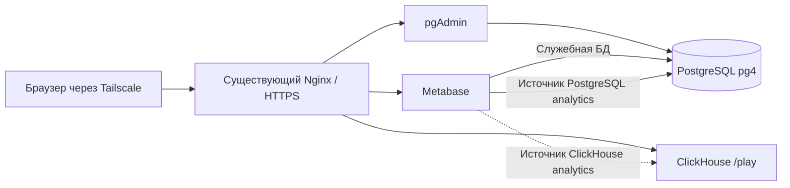

# Homelab Analytics Stack

**PostgreSQL 17 (pg4) + pgAdmin 4 + ClickHouse 26.7 + Metabase** — отдельный аналитический контур домашней Data Engineering Platform на HP-сервере под Ubuntu 24.04 и Docker Compose.

Этот проект предназначен для хранения аналитических данных, SQL-экспериментов, OLAP-запросов, визуализаций и BI-дашбордов. Он дополняет существующие [Outline / Keycloak / RustFS](https://github.com/glazole/outline_wiki), [Airflow](https://github.com/glazole/homelab-airflow) и [Spark / Iceberg / JupyterHub](https://github.com/glazole/homelab-sparkice), **не меняет** существующие БД pg1–pg3 и **не создаёт второй Nginx**.

Все сервисы можно включать **по требованию** и останавливать с сохранением данных: сервер располагает примерно 15 ГиБ RAM, а основная инфраструктура работает постоянно.

## 1. Сервисы и адреса

| Сервис | Назначение | Веб-адрес | Адрес внутри Docker |
|---|---|---|---|
| PostgreSQL pg4 | Отдельное SQL-хранилище, служебная БД Metabase | — | `pg4:5432` |
| pgAdmin 4 | Веб-администрирование PostgreSQL | [pgdb.handyman.moscow](https://pgdb.handyman.moscow) | `pgadmin:80` |
| ClickHouse | Колоночная OLAP-СУБД, SQL-консоль | [clickdb.handyman.moscow/play](https://clickdb.handyman.moscow/play) | `clickhouse:8123` |
| Metabase | BI, графики, дашборды | [metabase.handyman.moscow](https://metabase.handyman.moscow) | `metabase:3000` |

**Важно:** `pgdb.handyman.moscow` открывает **pgAdmin**, а не PostgreSQL по HTTPS. PostgreSQL использует собственный TCP-протокол, внутренний адрес `pg4:5432`.

В PostgreSQL `pg4` создаются:

- `postgres` — стандартная служебная БД;
- `metabase` — хранит пользователей Metabase, настройки, вопросы и дашборды, владелец `metabase_app`;
- `analytics` — самостоятельная песочница для аналитических данных, владелец `analytics_app`, пользователь чтения `analytics_ro`.

В ClickHouse отдельно создаются **другая** БД `analytics` и пользователь `homelab`. Metabase подключается к обеим аналитическим БД как к отдельным *источникам*. Создание служебной БД Metabase **не добавляет источники автоматически**.

### Архитектура



Применяются уже существующие Docker-сети:

- `outline-network` — Nginx ↔ веб-приложения;
- `homelab-db` — PostgreSQL и внутренние подключения аналитических сервисов.

Порты pg4, ClickHouse, pgAdmin и Metabase **не публикуются напрямую на хосте**. Все три веб-адреса маршрутизируются существующим контейнером `homelab-nginx`.

## 2. Структура репозитория

```text
homelab-analytics-stack/
├── README.md
├── .gitignore
├── start.sh                   # Запуск всех трёх Compose-проектов
├── stop.sh                    # Остановка только новых сервисов
├── install-nginx.sh           # Копирование 3 конфигураций в существующий Nginx
├── nginx/
│   ├── pgdb.conf
│   ├── clickdb.conf
│   └── metabase.conf
├── pg4/
│   ├── .env.example
│   ├── docker-compose.yml
│   ├── prepare.sh
│   ├── initdb/10-create-databases.sh
│   └── pgadmin/servers.json
├── clickhouse/
│   ├── .env.example
│   ├── docker-compose.yml
│   ├── prepare.sh
│   └── config.d/resources.xml
└── metabase/
    └── docker-compose.yml
```

Локальные пароли, `.env`, `secrets/`, сертификаты, логи и данные Docker volumes не коммитятся. Пример конфигурации `.env.example` содержит только placeholders.

## 3. Требования к HP-серверу

- Ubuntu 24.04, Docker Engine, Docker Compose v2, `openssl`, `sudo`;
- Docker-сети **`homelab-db` и `outline-network`** уже созданы;
- основной Nginx — в `~/projects/homelab/outline_wiki`;
- HTTPS-сертификат для поддоменов `handyman.moscow` уже установлен в Nginx;
- Tailscale, DNS для поддоменов через локальный `dnsmasq` или эквивалентный Split DNS;
- достаточный запас RAM (не запускать тяжёлые Spark- и ClickHouse-задания одновременно без измерения нагрузки).

Первоначальная диагностика:

```bash
docker compose version
docker network inspect homelab-db >/dev/null
docker network inspect outline-network >/dev/null
docker ps --format 'table {{.Names}}\t{{.Status}}'
free -h
tailscale ip -4
```

Ожидаемая структура на сервере:

```text
~/projects/homelab/
├── outline_wiki/
├── airflow/
├── sparkice/
└── homelab-analytics-stack/
```

Если репозиторий ещё не склонирован:

```bash
cd ~/projects/homelab
git clone git@github.com:glazole/homelab-analytics-stack.git
cd homelab-analytics-stack
chmod +x ./*.sh pg4/*.sh clickhouse/*.sh
```

## 4. Подробный первый запуск (по очереди)

Рекомендованный способ: **сначала PostgreSQL и pgAdmin, затем ClickHouse, затем Metabase**. После проверки каждого сервиса его можно остановить. Скрипт `./start.sh` сразу поднимает весь стек; его лучше использовать **после первичной настройки**.

### 4.1. Секреты и email для pgAdmin

```bash
cd ~/projects/homelab/homelab-analytics-stack
./pg4/prepare.sh
```

При первом вызове скрипт генерирует файлы паролей в `pg4/secrets/` и копирует `pg4/.env.example` в `pg4/.env`. Он завершится с просьбой заменить `admin@example.com`:

```bash
nano pg4/.env
```

Поставить свой email:

```ini
PGADMIN_DEFAULT_EMAIL=your-email@example.com
```

Повторить:

```bash
./pg4/prepare.sh
```

`prepare.sh` настраивает права файловых Docker secrets и использует `sudo chgrp`; возможен запрос системного пароля. Существующие пароли **не перегенерируются**.

### 4.2. PostgreSQL pg4

```bash
cd ~/projects/homelab/homelab-analytics-stack/pg4
docker compose config --quiet
docker compose up -d pg4
docker compose ps
docker compose logs --tail=80 pg4
```

Контейнер должен стать `healthy`. Проверяем список баз и ролей:

```bash
docker exec pg4 psql -U pg4_admin -d postgres -c   "SELECT datname FROM pg_database WHERE datistemplate = false ORDER BY datname;"

docker exec pg4 psql -U pg4_admin -d postgres -c   "SELECT rolname FROM pg_roles WHERE rolname IN ('metabase_app','analytics_app','analytics_ro') ORDER BY rolname;"
```

Должны присутствовать базы `analytics`, `metabase`, `postgres` и роли `metabase_app`, `analytics_app`, `analytics_ro`.

**Важно про initdb:** `pg4/initdb/10-create-databases.sh` выполняется только при **первом создании пустого** тома PostgreSQL. Если скрипт завершился с ошибкой из-за секретов, обычный перезапуск PostgreSQL **не повторит его**. Не удаляйте тома с данными ради повторного initdb; см. раздел «Неполадки».

### 4.3. pgAdmin 4

```bash
cd ~/projects/homelab/homelab-analytics-stack/pg4
docker compose up -d pgadmin
docker compose ps
docker compose logs --tail=60 pgadmin
```

Первый запуск веб-приложения может занять пару минут. Проверка HTTP прямо в контейнере, **без Nginx**:

```bash
docker exec homelab-pgadmin python3 -c   "import urllib.request; print(urllib.request.urlopen('http://127.0.0.1:80/', timeout=10).status)"
```

Ожидается `200`. При запуске pgAdmin применён `user: "5050:5050"` для чтения файловых secrets.

После настройки Nginx войти на `https://pgdb.handyman.moscow`:

- **Email** — `PGADMIN_DEFAULT_EMAIL` из `pg4/.env`;
- **Пароль pgAdmin** — из `pg4/secrets/pgadmin_password`;
- Встроенное соединение `pg4 | Homelab` использует `pg4:5432`, логин `pg4_admin` и **другой пароль** из `pg4/secrets/pg4_admin_password`.

Не публиковать содержимое файлов паролей в чат или Git.

### 4.4. ClickHouse

```bash
cd ~/projects/homelab/homelab-analytics-stack
./clickhouse/prepare.sh

cd clickhouse
docker compose config --quiet
docker compose up -d clickhouse
docker compose ps
docker compose logs --tail=60 clickhouse
```

Ожидается `healthy`. Проверить SQL:

```bash
docker exec homelab-clickhouse sh -c   'clickhouse-client --user "$CLICKHOUSE_USER" --password "$CLICKHOUSE_PASSWORD" --query "SELECT version(), currentUser(), currentDatabase()"'

docker exec homelab-clickhouse sh -c   'clickhouse-client --user "$CLICKHOUSE_USER" --password "$CLICKHOUSE_PASSWORD" --query "SHOW DATABASES"'
```

В ответе `SHOW DATABASES` ожидается `analytics`. Если `currentDatabase()` показывает `default`, это нормально: текущая БД не была явно указана.

Через веб-интерфейс `https://clickdb.handyman.moscow/play` используются логин `homelab` и пароль `CLICKHOUSE_PASSWORD` из `clickhouse/.env`.

### 4.5. Metabase

Metabase должен стартовать **после pg4**, так как ему нужна БД `metabase`. Между отдельными Compose-проектами нет общего `depends_on`, поэтому проверяем готовность:

```bash
docker exec pg4 pg_isready -U pg4_admin -d metabase

cd ~/projects/homelab/homelab-analytics-stack/metabase
docker compose config --quiet
docker compose up -d metabase
docker compose ps
docker compose logs --tail=80 metabase
```

Дождаться сообщения:

```text
Metabase Initialization COMPLETE
```

Быстрая проверка:

```bash
docker compose logs metabase 2>&1 | grep 'Metabase Initialization COMPLETE' | tail
```

Во время проверенного запуска Metabase выдавал предупреждение `No LLM provider connection named "anthropic" is configured`, связанное с необязательными AI-подсказками; оно **не помешало** работе BI и завершению инициализации.

## 5. DNS через Tailscale и HTTPS

### 5.1. DNS

В существующем Homelab используется `dnsmasq`, конфигурация — `/etc/dnsmasq.d/handyman.conf`. Сервер DNS слушает **Tailscale IP**, а не `127.0.0.1`.

Добавить в файл (если записей ещё нет) три строки, подставив фактический IP из `tailscale ip -4`:

```text
host-record=pgdb.handyman.moscow,<TAILSCALE_IP_HP>
host-record=clickdb.handyman.moscow,<TAILSCALE_IP_HP>
host-record=metabase.handyman.moscow,<TAILSCALE_IP_HP>
```

**Не создавать дублирующие записи:** в текущем стенде `metabase.handyman.moscow` уже был настроен ранее.

Проверить:

```bash
sudo dnsmasq --test
sudo systemctl restart dnsmasq

HP_TS_IP="$(tailscale ip -4)"
dig @"$HP_TS_IP" pgdb.handyman.moscow +short
dig @"$HP_TS_IP" clickdb.handyman.moscow +short
dig @"$HP_TS_IP" metabase.handyman.moscow +short
```

Все три ответа должны возвращать Tailscale IP. Для доступности с ноутбука клиенту Tailscale нужно применять соответствующий DNS/настройки Split DNS.

### 5.2. Nginx

Nginx здесь **не разворачивается заново**. Если существующий `homelab-nginx` не запущен:

```bash
cd ~/projects/homelab/outline_wiki
docker compose up -d nginx
```

Перед копированием проверьте, нет ли уже блоков для этих доменов в `outline_wiki/nginx/conf.d`. Скрипт копирует три конфигурации в существующий Nginx:

```bash
cd ~/projects/homelab/homelab-analytics-stack
./install-nginx.sh
```

Скрипт заменяет одноимённые файлы, проверяет `nginx -t` и перезагружает конфигурацию. Если необходимо подключать адреса по одному, используйте ручное копирование:

```bash
cp nginx/pgdb.conf ../outline_wiki/nginx/conf.d/pgdb.conf
docker exec homelab-nginx nginx -t
docker exec homelab-nginx nginx -s reload
```

Аналогично для `clickdb.conf` и `metabase.conf`.

Проверки:

```bash
docker exec homelab-nginx getent hosts pgadmin
docker exec homelab-nginx getent hosts clickhouse
docker exec homelab-nginx getent hosts metabase

# -k допустим только для диагностики локального сертификата
curl -k -I https://pgdb.handyman.moscow/
curl -k -I https://clickdb.handyman.moscow/play
curl -k -i https://metabase.handyman.moscow/api/health
```

Последний endpoint должен отвечать `{"status":"ok"}`. Для обычного браузера корневой CA должен быть доверенным; постоянное отключение проверки TLS не требуется.

**Важные исправления, уже включённые в репозиторий:**

- В ClickHouse монтируется **один файл** `./config.d/resources.xml`. Монтирование всей папки `config.d` скрывало штатные настройки контейнера и вызывало `502 Bad Gateway` (порт `8123` не слушал Docker-интерфейс).
- В `nginx/clickdb.conf` **нет** редиректа `location = / { return 302 /play; }`. Такой редирект ломал SQL-запросы интерфейса ошибкой `Unexpected token '<'`. UI открывается напрямую через путь `/play`.

## 6. Настройка источников Metabase

Открыть `https://metabase.handyman.moscow`, при первом запуске создать администратора Metabase. Это **отдельная** учётная запись, не связанная автоматически с Keycloak, pgAdmin или PostgreSQL.

Служебная БД приложения задаётся автоматически через переменные `MB_DB_TYPE=postgres`, `MB_DB_HOST=pg4`, `MB_DB_DBNAME=metabase`, `MB_DB_USER=metabase_app`, `MB_DB_PASS_FILE=/run/secrets/metabase_app_password` в `metabase/docker-compose.yml`.

В `Admin → Databases` добавить аналитический источник:

| Параметр | PostgreSQL | ClickHouse |
|---|---|---|
| Host | `pg4` | `clickhouse` |
| Port | `5432` | `8123` |
| Database | `analytics` | `analytics` |
| User | `analytics_ro` | `homelab` |
| Пароль | `pg4/secrets/analytics_ro_password` | `CLICKHOUSE_PASSWORD` из `clickhouse/.env` |

Источник ClickHouse будет доступен только при запущенном контейнере ClickHouse. Для внутреннего соединения PostgreSQL в проверенном стенде SSL не включали; для недоверенных сетей это не универсальная рекомендация.

### Тест PostgreSQL → Metabase → график

Создать небольшой набор данных в `pg4.analytics`:

```bash
docker exec -i pg4 psql -v ON_ERROR_STOP=1 -U pg4_admin -d analytics <<'SQL'
CREATE TABLE IF NOT EXISTS public.homelab_bi_test (
  event_date DATE,
  service VARCHAR(50),
  records_count INTEGER
);
TRUNCATE TABLE public.homelab_bi_test;
INSERT INTO public.homelab_bi_test VALUES
('2026-10-14', 'Spark', 120),
('2026-10-14', 'Airflow', 85),
('2026-10-15', 'Spark', 240),
('2026-10-15', 'Airflow', 160),
('2026-10-16', 'Spark', 350),
('2026-10-16', 'Airflow', 210);
GRANT USAGE ON SCHEMA public TO analytics_ro;
GRANT SELECT ON public.homelab_bi_test TO analytics_ro;
SQL

docker exec pg4 psql -U analytics_ro -d analytics   -c "SELECT * FROM public.homelab_bi_test ORDER BY event_date, service;"
```

После **синхронизации схемы** Metabase должен увидеть таблицу `Homelab Bi Test`. Для проверенного графика использовались сумма `Records Count`, группировка `Event Date` по дням, разбиение `Service` и линейная визуализация Spark/Airflow.

Создайте и сохраните вопрос и дашборд, если хотите проверить сохранение настроек Metabase. **Не удаляйте тестовую таблицу**, пока сохранённый дашборд от неё зависит.

## 7. Запуск по требованию и остановка

| Сценарий | Необходимые контейнеры |
|---|---|
| Только PostgreSQL | `pg4` |
| PostgreSQL через браузер | `pg4` + `pgadmin` |
| Только OLAP | `clickhouse` |
| BI на PostgreSQL | `pg4` + `metabase` |
| BI на PostgreSQL и ClickHouse | `pg4` + `metabase` + `clickhouse` |

**pg4:**

```bash
cd ~/projects/homelab/homelab-analytics-stack/pg4
docker compose up -d pg4
# Остановить:
docker compose stop pg4
```

**pg4 + pgAdmin:**

```bash
cd ~/projects/homelab/homelab-analytics-stack/pg4
docker compose up -d pg4 pgadmin
# Остановить:
docker compose stop pgadmin pg4
```

**ClickHouse:**

```bash
cd ~/projects/homelab/homelab-analytics-stack/clickhouse
docker compose up -d clickhouse
# Остановить:
docker compose stop clickhouse
```

**Metabase + pg4:**

```bash
cd ~/projects/homelab/homelab-analytics-stack/pg4
docker compose up -d pg4
cd ../metabase
docker compose up -d metabase
# После работы:
docker compose stop metabase
cd ../pg4
docker compose stop pg4
```

**Полный запуск** (после первого успешного развёртывания):

```bash
cd ~/projects/homelab/homelab-analytics-stack
./start.sh
```

`start.sh` запускает **все** три проекта, включая pgAdmin, проверяет сети, выполняет подготовку и ожидает появления служебной БД Metabase. Он **не** создаёт Docker-сети и **не** поднимает общий Nginx.

**Остановить весь дополнительный стек:**

```bash
cd ~/projects/homelab/homelab-analytics-stack
./stop.sh
```

Это остановит Metabase, ClickHouse, pg4 и pgAdmin, но **не затронет** основное ядро: Outline, Keycloak, Airflow, Spark, Iceberg, JupyterHub, RustFS, pg1–pg3, Nginx.

Данные сохраняются в named volumes. **Не использовать `docker compose down -v` для обычной остановки.** При конфигурации `restart: unless-stopped` ручная остановка учитывается Docker и при штатном перезапуске демона.

## 8. Ограничения ресурсов и мониторинг

| Контейнер | Лимит Compose |
|---|---:|
| pg4 | 768 МиБ |
| pgAdmin | 640 МиБ |
| ClickHouse | 3 ГиБ |
| Metabase | 1800 МиБ (Java heap до 1024 МиБ) |

Дополнительно в `clickhouse/config.d/resources.xml` установлены `max_server_memory_usage=2147483648` (2 ГиБ) и `max_concurrent_queries=4`. **Лимиты — не зарезервированная память.**

В измеренном базовом состоянии HP-сервера, без analytics-контейнеров, использовалось около **3,6 ГиБ RAM**, было **11 ГиБ available**, swap — **0**. Это ориентир для простоя, а не гарантия поведения при тяжёлых Spark/ClickHouse задачах.

Команды измерения:

```bash
free -h
swapon --show
docker stats --no-stream   --format 'table {{.Name}}\t{{.MemUsage}}\t{{.CPUPerc}}'
vmstat 1 5
```

## 9. Известные проблемы и решения

| Симптом | Проверка / решение |
|---|---|
| `Permission denied` при `./prepare.sh` | `chmod +x pg4/prepare.sh` |
| pg4 `healthy`, но нет `metabase` и `analytics` | Проверить `docker compose logs pg4`: initdb выполняется лишь один раз |
| `cat: /run/secrets/metabase_app_password: Permission denied` | Проверить владельца/группу секретов, выполнить `./pg4/prepare.sh` повторно |
| pgAdmin: `PGADMIN_DEFAULT_PASSWORD_FILE ... not readable` | Проверить `user: "5050:5050"`, группу `5050`, права файла `640`; пересоздать только pgAdmin при изменении Compose |
| pgAdmin `Connection refused` сразу после запуска | Подождать завершения первоначальной инициализации, проверить логи |
| ClickHouse `502 Bad Gateway` на :8123 | Не перекрывать каталог `config.d` образа; монтировать только `resources.xml` |
| ClickHouse UI возвращает HTML вместо JSON | Убрать Nginx-редирект с `/` на `/play` |
| Metabase не видит новую таблицу | Проверить SELECT-права и вручную синхронизировать схему источника |
| Metabase сообщает об отсутствующем Anthropic | Функция AI-подсказок необязательна для проверенного сценария BI |
| `dig @127.0.0.1` — отказ | Проверять `dig @$(tailscale ip -4)`: dnsmasq слушает интерфейс Tailscale |

**Осторожно с повторным initdb.** В нашем первоначальном развёртывании PostgreSQL успел создать кластер, но скрипт остановился из-за прав secrets; дополнительные роли и БД отсутствовали. После исправления прав скрипт был выполнен вручную:

```bash
# Только если роли/БД ещё НЕ были созданы и состояние проверено!
docker exec -u 0 pg4 bash /docker-entrypoint-initdb.d/10-create-databases.sh
```

Этот скрипт **не идемпотентен**: на уже частично/полностью инициализированной базе может завершиться ошибкой. Не повторяйте без проверки содержимого БД и **не удаляйте Docker volumes** как способ устранения ошибки.

## 10. Безопасность, резервные копии и воспроизводимость

- **Tailscale/VPN и ограничение доступа обязательны** для частного стенда. Одна DNS-запись не является средством авторизации. Особенно опасно публично открывать ClickHouse HTTP: он позволяет выполнять SQL, а не только просматривать `/play`.
- Для pgAdmin и Metabase используются их **собственные** учётные записи: SSO Keycloak в этом репозитории **не настроен**.
- Хранить пароли, secrets, закрытые ключи, сертификаты, корпоративные данные и дампы **вне Git**. Проверять не только дерево файлов, но и историю перед переводом репозитория в Public.
- Права `analytics_ro` рассчитаны на чтение; таблицы, созданные не владельцем `analytics_app`, могут потребовать отдельного `GRANT SELECT`.
- Образ `metabase/metabase:latest` выбран при развёртывании. Для воспроизводимости следует закрепить проверенный тег или digest, а обновления тестировать отдельно.
- Резервировать PostgreSQL `metabase` (вопросы/дашборды), `analytics`, volumes ClickHouse и pgAdmin, а также **защищённые копии секретов**. Проверять возможность восстановления. Одного Git-репозитория недостаточно.
- При восстановлении не подменять существующие пароли новой генерацией без плана миграции/смены credentials.

## 11. Что уже проверено на сервере (октябрь 2026)

- **PostgreSQL 17.11:** `healthy`, создание баз `postgres`, `metabase`, `analytics` и пользовательских ролей; SELECT в аналитической БД.
- **pgAdmin 4 / 9.17:** HTTP 200, вход через `pgdb.handyman.moscow`, соединение с pg4.
- **ClickHouse 26.7.32.7:** создание `MergeTree`, INSERT/SELECT, запросы через клиент и веб-консоль `clickdb.handyman.moscow/play`.
- **Metabase:** сообщение `Metabase Initialization COMPLETE`, служебная БД в pg4, подключение `analytics`, чтение шести строк, линейный график Spark/Airflow через HTTPS.
- **dnsmasq + Tailscale + Nginx:** разрешение трёх поддоменов, HTTPS-доступ к сервисам.

Не заявляется, что уже протестированы полное восстановление из бэкапа, Keycloak SSO, все будущие версии `latest` или тяжёлая одновременная нагрузка.

---

**Другие репозитории:** [outline_wiki](https://github.com/glazole/outline_wiki) · [homelab-airflow](https://github.com/glazole/homelab-airflow) · [homelab-sparkice](https://github.com/glazole/homelab-sparkice).
